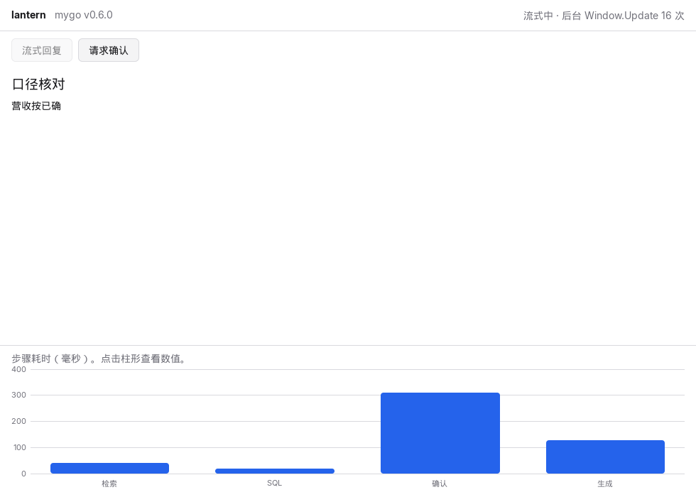
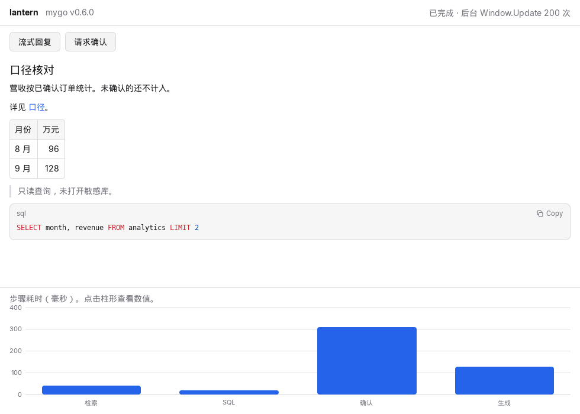
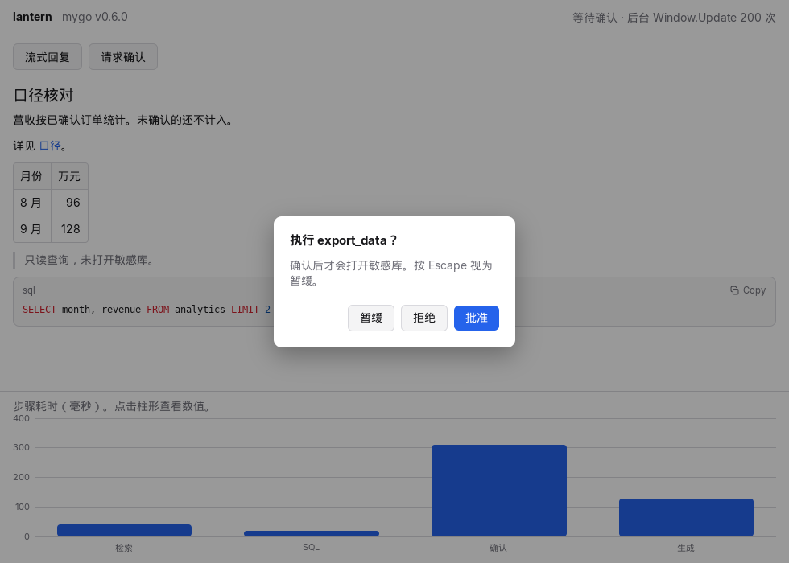

# ADR 0002：mygo v0.6.0 最小窗口

- 状态：已接受（spike）
- 日期：2026-10-21
- 相关：issue #8，技术设计 v0.3 §5（事件流、Approver）、§11、§13.6

## 背景

桌面端选定 mygo，并且只有 `internal/ui` 可以 import 它。技术设计把 W1 的 mygo spike 定为半天：最小窗口，确认三件库能力和一种线程模型能用。

1. `markdown.Stream` 能边收边画，收完再交给 `markdown.View`。
2. `ui.AlertDialog` 能做确认单。Escape 视为暂缓。
3. `ui/chart` 能画我们自己上色的图表。
4. 后台 goroutine 可以调用 `Window.Update`，在主线程上改状态并请求下一帧。这是 core 事件流进 UI 的接法：core 把事件放进 channel，UI 的 goroutine 取出来，只在 `Window.Update` 的回调里改界面状态。

## 决策

版本保持 **mygo v0.6.0**（commit `081639f2a55d62a09aca742684827937dac6cb39`）。`go.mod` 里原有的「8 周内不主动升级」不变。这次没有升版本。

mygo 的 import 仍然只出现在 `internal/ui`。spike 的入口是 `internal/ui/cmd/spike`，它只调用 `ui.RunSpike`，自己不 import mygo。`cmd/lantern` 不进入这个窗口。spike 不是产品壳。

接法按下面四条，供后面的界面使用：

- 回复还在增长时用 `markdown.Stream`，结束时在同一位置换成 `markdown.View`，两者共用一份 `markdown.Options`，解析状态能接着用。
- 中文回复的 `Reveal.Unit` 用 `BySentence`。v0.6.0 的 `ByWord` 只在空格和换行处截断，一段没有空格的中文会被当成一个词。`。！？` 和换行能切开句子。
- 别的 goroutine 不直接写界面状态。它调用 `Window.Update`，回调在主线程执行，然后再画一帧。点击处理跑在主线程上，只负责启动 goroutine，不在主线程上等待 `Update`，否则会和主循环互相等。
- 确认单用 `ui.AlertDialog`。按钮是「暂缓」「拒绝」「批准」，最后一个是默认按钮。返回值 `0` 和 `AlertDismissed`（Escape，值为 -2）都记成暂缓。

图表用 `ui/chart` 的刻度和 `chart.Rect`，颜色用窗口主题的 accent。库不带默认皮肤。

构建保持 `CGO_ENABLED=0`。mygo 用 purego 加载 GTK 3，native UI 不需要 WebKitGTK。

## 怎么验证的

无窗口的行为用 `ui.NewTester`，时钟用 `Advance` 推，不依赖显示器。`CGO_ENABLED=0 go test ./internal/ui/` 通过。覆盖：

- 未闭合的 `**已确` 会画成文字，画面上没有星号，表格和代码还没出现。
- `BySentence` 只显示已经写完的句子（以 `。` 结束），未写完的「未确认的还不」先不出现；改成 `View` 之后出现。
- 全文结束后能看到表格、引用和 SQL。
- Escape 得到「暂缓」；点击「拒绝」「批准」得到对应结果，确认框随后关闭。
- 四根柱的类目能被读到；点击「检索」柱后，说明变成「选中：检索 42 ms」。
- 没有窗口时，`feed` 仍按每个 rune 记一次，完成再记一次。

真窗口在本机没有接到一块可用的物理屏幕上，改用 Xvfb：

```sh
GDK_BACKEND=x11 xvfb-run -a -s "-screen 0 1400x900x24" \
  env CGO_ENABLED=0 go run ./internal/ui/cmd/spike -shots docs/adr/img
```

程序在后台 goroutine 里逐个 rune 调用 `Window.Update`，在截断点、全文结束、确认框打开这三处调用 `Window.CapturePage`。三张 PNG 都不是纯色，而且两两不同。stderr 里有一行：

```text
mygo: native UI draws without the GPU: there is none
spike: version=0.6.0 updates=200 asking=true
```

截图时把 `Reveal` 设成 `AtOnce`、`Fade` 设成负数，避免抓到淡入的半透明中间帧。交互运行（不加 `-shots`）仍用 `BySentence`。

## 观察到的结果

### 流式 Markdown

截断点设在 `营收按**已确`。此时状态栏是「流式中 · 后台 Window.Update 16 次」，16 等于这段前缀的 rune 数。标题已经排成标题，「已确」出现在画面上，没有 `**`，表格和代码块都还没有。



全文 199 个 rune，再加一次「写完」的 `Update`，状态栏变成「已完成 · 后台 Window.Update 200 次」。同一块区域换成 `markdown.View` 之后是普通 CommonMark：粗体、链接、表格、引用，以及带高亮的 sql 代码块。代码块自带的 Copy 按钮文案是英文，这次没有改。



### alert-dialog

`asking == true` 时，窗口中央盖住一张确认框，背后变暗。默认按钮是「批准」（强调色）。Escape 和点击「暂缓」在测试里都记成暂缓，点击「拒绝」「批准」得到对应结果。库的文档写明点外面不会关，这次没有再点一次外面。



### ui/chart

`chart.NewBand` 加 `chart.NewLinear(0, 360).Nice(4)`，纵轴落到 0–400。四根柱是检索 42、SQL 18、确认 310、生成 128，高低和数值一致。中文类目由 fontconfig 回退画出来了（本机有文泉驿微米黑和 Droid Sans Fallback），没有方框。柱形点击只在 `ui.NewTester` 里点过，截图没有再点一次。

### Window.Update

`Window.Update` 把回调排到主线程，自己马上返回。spike 在回调末尾关闭一个 channel，后台 goroutine 用它确认这次写入已经发生，然后再抓图。状态只在回调里改。截图上的 16 和 200 就是这样加出来的，和没有窗口的 `feed` 用的是同一段计数。

主线程上的按钮只做 `go feed(...)`。在主线程里调用 `Update` 再等待回调，会和事件循环卡住。

## 后果

- `go.mod` 多了间接依赖 `github.com/go-text/typesetting v0.3.5` 和 `golang.org/x/image v0.46.0`。它们随 `ui/markdown` 和 `ui/chart` 进来，仍然是纯 Go。mygo 版本号没变。
- 跑起窗口需要 GTK 3、Pango 和 fontconfig。不需要 WebKitGTK，这次也没有加载网页。
- Xvfb 上没有 GPU，mygo 改走软件光栅，`CapturePage` 仍然画出了上面三张图。有 GPU 的机器会走 OpenGL，这条路径这次没测。
- CI 里的界面测试走 `ui.NewTester`，不需要显示器，也不需要 Xvfb。
- 生产环境应按一批 token 调一次 `Update`。spike 故意拆成 rune，只是为了确认连续调用能按顺序落到主线程。

## 不在这次里

- 不把 core 的 `events.Event` 接进来。channel 到 `Window.Update` 的形状留在这里，等事件流有了再接。
- 不改 `cmd/lantern`。桌面入口仍是占位。
- 不在有 GPU 的系统上复测绘制路径。
