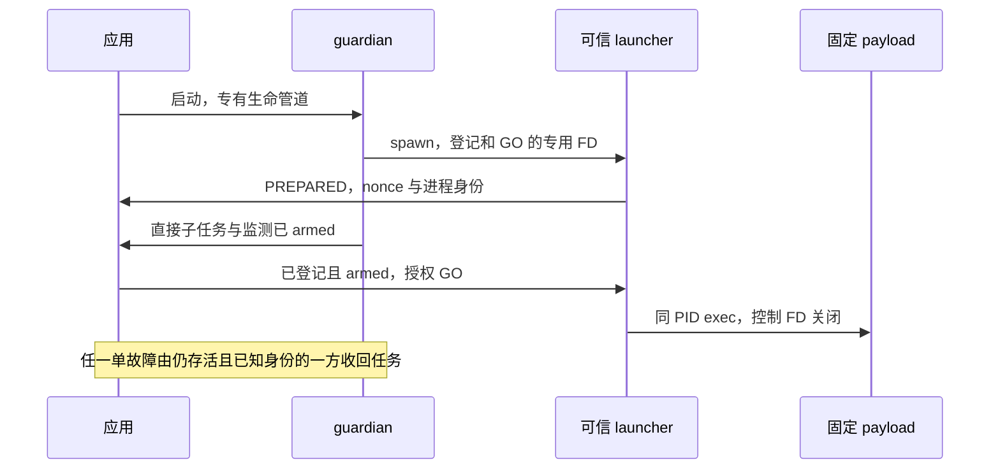

# ADR 0011：Darwin 单故障互监与启动交接

## 状态与问题

候选验证中（#54），尚无本轮原生实验结果。#52 已证明固定隔离与资源实验可运行，也实际发现 guardian 死亡后任务仍存活。生产 Darwin Runner/SQL worker 仍保持不可用；本轮只收敛这一监督缺口的故障模型与固定实验，不接入模型任意代码。

## 故障模型

一次仅一个可信进程意外退出或被 SIGKILL，其余观察者存活且可调度。应用和 guardian 任一方死亡都应由存活方终止任务、确认退出并清理。双杀、全部观察者 SIGSTOP、内核/整机故障与同用户主动篡改不在已承诺单故障范围内。异步 pipe EOF/kqueue 不是内核原子 Pdeathsig，不承诺对方死亡瞬间之后绝无一次 exec。

主候选复用应用作为第二监管者，不先增加第二个额外 guardian：guardian 是任务的直接父进程；应用保存任务身份，guardian 死亡后负责终止并观察孤儿实际消失。只有直接父进程才能 Wait，不能把应用观察 orphan absence 写成应用 Wait 了孙进程。

## 先登记和 armed，再 GO

仅在 guardian 启动后把 PID 转发给应用仍有漏洞：guardian 可能在 spawn 任务后、转发前死亡。候选由可信 launcher 直接向应用登记 nonce/PID/birth/允许镜像，在应用登记且 guardian 监测 armed 前阻塞；应用直接授权 GO，之后同一 PID 才 exec 固定 payload。

登记 writer 的副本在 guardian spawn 后关闭，仅 launcher 保留；GO writer 仅应用持有；应用生命 writer 也不得被 launcher/payload 继承。执行前关闭或设置 CLOEXEC，防止不相关副本遮蔽 EOF。每条消息有固定版本、长度预算、job nonce 和时序约束，协议失败或有界超时不得 GO。

PID/birth/镜像复核不是 pidfd 原子句柄。允许的镜像包含已验证可信启动链，任务 setsid/setpgid 不改变登记 PID。并发自然退出、错误、取消与正常 helper drain 必须有明确状态机，不能在成功回收前解除监督，也不能把双方正常退出误判成需要误杀的故障。

## 固定实验与出口

独立 `supervision` 子命令与 `lantern.darwin-supervision.v1` 报告，不改变 #52 的八阶段、65 检查和原 guardian 负面观测。固定 18 项：四启动窗分别注入应用/guardian 故障（8）；稳态故障（2）；setsid 后故障（2）；setpgid 后故障（2）；正常、错误、取消、退出与取消并发（4）。

首窗明确为 guardian 已存在、尚未 spawn 任务 launcher；其余为 spawn 后应用未接受登记、已登记尚未 armed、armed 尚未 GO。通过事件和 ack 精确暂停注入，不用 sleep 猜测。每 case 最长 8 秒、整轮 4 分钟、故障至终止/身份消失最长 2 秒，worker 初始 Wall 不超过 5 秒；这些是待实际验证的实验预算。

成功必须同时满足阶段、真实身份/进入或未进入证据、直接 Wait 与孤儿消失、所有自有进程终结、目录清理，且 harness_rescue=false。harness 仅在失败后做明确标记的救援，不能把救援变成候选机制能力。基线完整后，独立移除关键监督与 GO 门控，必须出现对应真实目标失败，不能用编译、前检或外层超时假红。

若候选仍不可行，可据原生证据形成 negative 研究结论；生产监督器依赖仍阻塞。最终提交的专项、全量、平台/原生 CI、独立变异、review 正文、合并/main 与 lantern-notes 同轮完成才收口，W4 不随本轮研究关闭。
